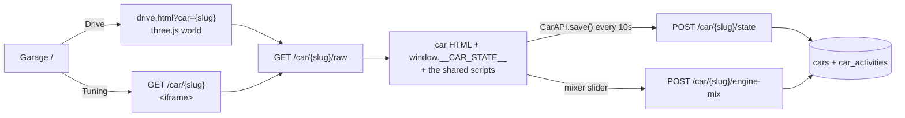

<div align="center">

# 🏎️ Instrument Cluster Simulator

**Real cars in your browser** — drive them through an open world and round the real Nürburgring, tune them on a
dyno, service them at the mechanic, and hear an engine that is synthesised live, not sampled.

Each car is a single hand-built HTML page: its gauges, powertrain and sound. Shared scripts give every car tuning,
servicing, diagnostics, a dyno and a history; a three.js world gives it roads to drive on. Laravel gives it a garage
and a memory.


</div>

---

## 🔎 What is this?

Pick a car in the **garage** and press **Drive**. It starts outside your home garage in a 3D world with an autobahn,
mountain roads, a village, a city, a racetrack and the Nordschleife. The in-car view shows the car's own live
instrument cluster in the dash. Press **Tab** and the whole car page opens over the road: every control, live data,
the tuning maps, the dyno and the diagnostics, while the car keeps rolling.

There is no engine audio sample anywhere. Firing pulses, exhaust drone, turbo whistle, blow-off, intake and gear
whine are all generated with the Web Audio API from the current rpm, boost and load, in each engine's real firing
order.

Everything you do sticks: odometer, fuel, engine wear, worn parts, fault codes, tunes, layouts and your sound mix
are saved per car, and every drive, refuel, service and tune is logged so you can put the car back to any point.

---

## 🚗 The cars

| Car | Engine | Gearbox | 3D drive | What's special |
|---|---|---|:--:|---|
| BMW X1 xDrive20d (E84) | N47 2.0 diesel I4 | ZF 6HP | ✅ | xDrive, DSC, DS gearbox |
| BMW 320d (F30) | B47 2.0 diesel I4 | ZF 8HP | ✅ | rear-drive diesel, maps up to Stage 3 |
| BMW M140i xDrive | B58 3.0 turbo I6 | ZF 8HP | ✅ | xDrive switchable to 2WD, paddles |
| BMW 530e xDrive | B48 2.0 turbo I4 + motor | ZF 8HP eDrive | ✅ | plug-in hybrid: eDrive modes, plug in to charge (drives on the M550d's body) |
| BMW M550d xDrive (550d Mk2) | B57 3.0 quad-turbo diesel I6 | ZF 8HP | ✅ | bootmod3 maps, big-turbo builds |
| BMW M3 Competition Touring | S58 3.0 twin-turbo I6 | ZF 8HP | ✅ | engine / chassis / steering / brake set-up, M xDrive, M Mode, MTC, M1/M2 |
| BMW M5 CS | S63 4.4 twin-turbo V8 | ZF 8HP | ✅ | as the M3, plus M Sound and storable M1/M2 |
| BMW M5 E60 | S85 5.0 V10 | SMG III | ✅ | Drivelogic, BMW's launch-control procedure, POWER / EDC / MDrive, 9,500 rpm cut |
| Porsche 911 GT3 RS | 4.0 flat-six (no turbo) | PDK | ✅ | 9,000 rpm, PSM, twin-turbo kits up to ~960 hp; drives lime with a black bonnet and white wheels, the grippiest car in the garage |
| BMW 550D | twin-turbo diesel I6 | ZF 8HP | — | the original cluster |
| Proton Iriz | petrol I4 | CVT | — | hatchback cluster |

Clusters are matched to reference photos of the real cars, down to the numeral fonts.

---

## ✨ Features

### 🌍 The drive world (`public/drive.html`)

| | |
|---|---|
| 🛣️ **Autobahn** | A ~17 km top-speed oval, 3 lanes each way, U-turn flyovers, an on-ramp and fuel stations |
| ⛰️ **Mountain loop** | ~15 km of switchbacks up to a ~320 m summit lay-by with benches and a coin telescope |
| 🏘️ **Village** | Stone houses, a church and its bell tower, a square with a fountain, cobbled lanes |
| 🏙️ **City** | A street grid in a ring road, a roundabout, towers with a skybridge, a 200 m observation tower |
| 🏁 **Racetrack** | ~9 km with kerbs, gravel, chicanes, a grandstand, start lights, a pit lane and 12 garages |
| 🟢 **Nordschleife** | The real 20.7 km lap from OpenStreetMap with real heights, Armco, and its pits on Döttinger Höhe |
| 🏠 **Places that do things** | Home garage (swap cars), the mechanic (servicing and repairs happen only there), fuel pumps (engine off to refuel), pit garages (swap, tune, refuel) |
| 💥 **Physical world** | Collisions with walls, rails, buildings and trees; crash sounds scaled to the hit |
| 🔥 **Backfire** | Flame from the tips on every overrun pop, burble and upshift crack the car's sound plays, timed to it: a flicker for a crackle, a bigger lick for a bang |
| 🛞 **Tyres and smoke** | Rubber marks on wheelspin, traction control and hard launches; tyre smoke; black diesel smoke that follows the tune |
| 🎥 **Views** | Chase view, and an in-car view with the live cluster in the dash of a right-hand-drive cabin; two-finger swipe to look around |
| 🗺️ **Mini map** | North-up, with fuel, home, the mechanics, the viewpoint, start lines, pit garages and the village |
| 🧪 **Dyno rollers** | In Dyno mode the wheels turn but the car stays put, so a pull can't drive you off |

### 🎛️ Every car page

| | |
|---|---|
| 🔊 **Synthesised engine** | Per-cylinder firing pulses in the real firing order, plus rasp, intake, exhaust, valvetrain, turbo whistle and gear whine layers |
| 🌀 **Turbo model** | Boost builds against real lag; quad-turbo staging on the M550d; a blow-off *pssht* on lift-off |
| 🚦 **Gearboxes** | Automatic with kickdown and coast-downs, manual and paddles, Drivelogic, SMG launch control |
| 🥶 **Cold start** | The starter cranks, catches and flares; the engine is down on power until it's warm |
| ⛽ **Fuel** | Burned from real BSFC figures; refuelled at the pump |
| 🔥 **Engine wear** | Hammering the limiter wears the engine, and it stays worn until repaired |
| 🎚️ **Drive modes** | Each car's own: xDrive / 2WD, DSC / PSM, M Mode, M1 / M2, EDC, POWER, eDrive, cruise control, lights |

### 🧰 Shared systems (`public/js/`, injected into every car)

| Script | What it adds |
|---|---|
| `car-tune.js` | **Tuning.** An engine model (air, fuel, ignition / injection) with per-cylinder knock. Maps for boost, timing, AFR or fuel quantity, injection timing and rail pressure; rev, shift and launch rpm, the speed limiter, a torque limit, shift speed, burbles, smoke, EGR / DPF; gear ratios, shift points and torque limits per gear. Presets per engine (Stage 1–3, bootmod3, big turbos, twin-turbo kits). A parts catalogue with real dependencies: turbo, intercooler, downpipe, charge pipes, diverter, injectors, fuel pumps, port injection, RON 95 / 98 / 102 / E85, forged or built internals, head gasket, gearbox, radiator, brakes and chassis. It warns you (lean, over the rods' torque, knock-limited) and punishes you: parts wear, fault codes, limp mode. Two map slots, a library of 20 saved setups, a datalog and a guide |
| `car-service.js` | **Servicing.** Oil life and level, coolant, brake pads, tyres and pressure, battery. Discs heat up and fade; worn pads and tyres stop longer; old oil wears the engine faster. Worn parts raise dashboard messages with a chime, and minor faults turn up with wear and mileage |
| `car-diagnostics.js` | **Diagnostics.** A scan tool: health ring, ECM / TCM / ABS / TPMS / BMS / BCM modules, fault memory you can clear, live data, and service functions like a compression test and DPF regeneration |
| `car-dyno.js` | **Dyno.** Logs power and torque as you drive, per gear, with AFR, knock, intake and exhaust temperature channels; runs save to the car's history and print as a PDF dyno sheet |
| `car-perf.js` | **Performance meter**, Dragy / VBOX style: 60 ft, 0–100, 0–200, 100–200, 200–300 km/h, ¼ / ½ / 1 mile, 100–0 m, peak g, top speed; pick a saved run and the next one races it as a ghost |
| `car-history.js` | **History.** Every drive, refuel, service, tune, part change, fault and run, with the state it left; **Restore** puts the car back to any of them |
| `car-layout.js` | **Layout.** Classic, Drive, Pitwall and Free presets; drag and resize areas with snapping; 3 saved layouts per car |
| `car-mixer.js` | **Sound mixer.** A slider per sound layer with solo buttons, saved per car |
| `car-api.js` | **Saving.** Every 10 s and on leaving the page. Only the latest-opened page may save, so an old tab can't overwrite newer progress |

### 📱 Your phone as the wheel (`public/pad.html`)

Tilt to steer, touch pedals, shift paddles, and the car's own buttons and drive modes. The phone shows gear, speed,
revs and shift lights. A small relay (`scripts/pad-relay.mjs`) passes messages between the phone and the drive page;
the phone reaches it over Tailscale (https, which iOS needs before it allows tilt), and its link is put on the
clipboard each time the drive page opens.

### 🗂️ The garage (Laravel)

| | |
|---|---|
| 🅿️ **Garage** | Photo cards; **Drive** opens the 3D world, **Tuning** the car's own page. A stats card shows hp / Nm against stock, odometer, fuel, wear, faults, upgraded parts, last drive and wear bars |
| 🛠️ **Manage** | Rename, nickname, subtitle, reorder, upload a photo, delete |
| ⬆️ **Upload** | Add a car by uploading its `.html` (≤ 5 MB) |

---

## ⌨️ Driving keys

| Key | Does |
|---|---|
| `I` | engine start / stop |
| `W` / `S` | throttle / brake |
| `A` / `D` | steer |
| `Space` | handbrake (runs a pull in Dyno mode) |
| `R` / `N` | reverse / neutral |
| `←` / `→` | turn signal (flashes 3 times) |
| `C` | in-car / chase view |
| `F`, `,` / `.` | cruise control, set speed −5 / +5 km/h |
| `↑` / `↓`, `O` / `P` | throttle limit, brake limit |
| `Tab` | the car menu: the whole car page over the road |

Each car adds its own (gearbox mode, paddles, maps, xDrive, DSC, M modes…), listed on its page.

---

## 🧭 How a car loads



The drive page loads the car page in a same-origin iframe: the car page runs the engine, gearbox and brakes and hands
its speed to the world each frame; the world steers it, moves it and draws it.

---

## 🛣️ Routes

| Method | URI | Does |
|--------|-----|------|
| `GET` | `/` | Garage |
| `GET` / `POST` | `/upload` | Upload form / store a new car |
| `GET` | `/manage` | Manage cars |
| `PATCH` / `DELETE` | `/car/{slug}` | Update name, nickname, subtitle / delete |
| `POST` | `/car/{slug}/move-up`, `/move-down` | Reorder |
| `POST` | `/car/{slug}/photo` | Garage photo |
| `GET` | `/car/{slug}` | Car page in an iframe shell |
| `GET` | `/car/{slug}/raw` | Car HTML with state and scripts injected (`?test_drive=1`: never saves) |
| `POST` | `/car/{slug}/state` | Save the car's state, with any activities |
| `POST` | `/car/{slug}/name` | Save the nickname |
| `POST` | `/car/{slug}/engine-mix` | Save the sound mix |
| `GET` | `/car/{slug}/activities` | History, newest first |
| `POST` | `/car/{slug}/activities/{id}/restore` | Put the car back to that point |

`public/drive.html?car={slug}` is a static page: `&at=pits` starts in the racetrack's pit garage, `&at=ring` at the
Nordschleife, `&test_drive=1` drives without saving.

---

## 🗃️ Data model

**`cars`**

| Column | Notes |
|--------|-------|
| `name`, `nickname`, `slug`, `subtitle`, `position` | `slug` is the route key; `nickname` shows over the model name |
| `file_path` | the car's HTML on the `public` disk |
| `odometer`, `fuel_level`, `engine_wear_pct`, `engine_map` | km, 0–1, 0–100, 1–9 |
| `oil_wear_pct`, `oil_level_loss_pct`, `coolant_loss_pct`, `brake_wear_pct`, `tyre_wear_pct`, `tyre_pressure_loss_pct`, `battery_drain_pct` | 0–100 % worn or lost |
| `service_wear`, `fault_codes`, `layout`, `tune`, `engine_mix` | json |

Every state column is nullable: `null` means the car's own default.

**`car_activities`**: `car_id`, `type` (drive, refuel, repair, service, tune, parts, fault, clear, damage, regen,
dyno, perf, rename, restore), `summary`, and a `snapshot` of the car's state, which is what a restore puts back.

---

## 🚀 Quick start

```sh
git clone <this-repo> && cd sim-app
composer setup                 # install, .env, key, migrate, npm install + build
php artisan db:seed            # BMW 550D, Proton Iriz, BMW 320D, M140i xDrive, 530e xDrive
php artisan storage:link       # serve the car files
```

Serve it at **http://sim-app.test** (Laravel Herd): the phone pad's relay only accepts the drive page from there.
`composer dev` runs the dev processes (Vite and friends) alongside.

The other cars' pages are in `resources/cars/`. Add them at `/upload`, named so the slug matches the file name
(`BMW M3 Touring` → `bmw-m3-touring`), and **Drive** finds their 3D model.

**Phone pad** (optional): `npm install`, sign in to Tailscale on the Mac and the phone, then `npm run pad:install` to keep the
relay running in the background (or `npm run pad` in a terminal). Open the drive page and the phone's link is on
your clipboard.

> [!TIP]
> Engine audio needs a user gesture: click or press a key before you expect sound. The drive page loads three.js
> from a CDN, so it needs a connection.

---

## 🔧 Add your own car

A car is one HTML file. To hook into the shared systems, its script:

1. Reads saved values from `window.__CAR_STATE__` (`odometer`, `fuelLevel`, `wearPct`, `engineMap`, `engineMix`, …).
2. Saves with `window.CarAPI.save({ odometer, fuel_level, engine_wear_pct, engine_map })`.
3. Registers its audio layers with `window.EngineMixer.register({ title, layers: [{ id, label, value, set }] })`.
4. Optionally calls `CarDyno.init` / `CarDyno.tick`, `CarService.tick` and `CarTune.init` for the dyno, servicing
   and tuning. Each script's header comment documents its contract.

Upload it at `/upload`. To drive it in 3D as well, add a `.glb` to `public/models/`, an entry to `CARS` in
`public/drive.html`, and its slug to `$drivable` in `resources/views/menu.blade.php`.

---

## 🧱 Stack

- **Laravel 13** · PHP 8.3+ · one controller (`CarSimController`)
- **SQLite** by default
- **three.js r182** for the drive world (from the jsDelivr CDN), **Web Audio** for every sound
- **Vite + Tailwind 4** for the garage; no frontend framework
- **Node + ws** for the phone pad relay

## ✅ Tests

```sh
composer test
```

Feature tests cover the garage menu, layouts, names, and the tune / history / restore flow (`tests/Feature/`). The
drive page and the shared scripts run their own self-checks on load (steering, collisions, road heights, the phone
pad's tilt) and report failures in the browser console.

## 🙏 Credits

- 3D models from Sketchfab, credited on the drive page: X1, M3 CS Touring, M5 Competition, M140i and 911 GT3 RS by
  [Ddiaz Design](https://sketchfab.com/ddiaz-design); F30 by DEMON_SCARY1235; G30 by Mona x Supercars; E60 by
  GT Cars: Hyperspeed. Licences are CC BY-NC-SA 4.0 or CC BY 4.0, as shown per car.
- Nordschleife line: © [OpenStreetMap](https://www.openstreetmap.org/relation/38566) contributors (ODbL); heights
  from the Copernicus DEM via [Open-Meteo](https://open-meteo.com/).
