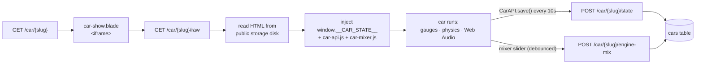

<div align="center">

# 🏎️ Instrument Cluster Simulator

**Drive a car's dashboard in your browser** — analog needles, a live dyno, and a
synthesised engine you can hear spool, rev, and blow off boost.

Each car is a single hand-built HTML file. Laravel gives it a garage, an upload
door, and a memory.


</div>

---

## 🔎 What is this?

A working car **instrument cluster** — tachometer, speedo, boost gauge, coolant
temp, fuel, HP/torque dials — that reacts to a throttle slider and a gearbox in
real time. There's no engine audio sample anywhere: the exhaust drone, turbo
whistle, intake whoosh and gear whine are all **generated live** with the Web
Audio API from the current rpm, boost and load.

The Laravel side is deliberately thin. It lists the cars, lets you upload new
ones, serves each car's raw HTML into an `<iframe>`, and remembers where you left
each one — odometer, fuel, engine wear, drive mode, and every sound-mixer slider.

<div align="center">

| Garage | Cluster | Upload |
|:--:|:--:|:--:|
| Pick a car, hit **Start Engine** | Drive it, tune it, log a dyno pull | Drop in your own HTML cluster |

</div>

---

## ✨ Features

### 🎛️ The simulation (lives in each car's HTML)

| | Feature |
|---|---|
| 🌀 **Live turbo model** | Boost pressure builds against real turbo lag — sustain >50% throttle and watch it come on song. Quad-turbo on the 550D (2 low-pressure always spooled + 2 high-pressure), single on the 320D. |
| 🔊 **Fully synthesised engine** | Firing pulses at the real per-cylinder rate (an I6 *buzzes*, an I4 *chugs*), plus separate layers for combustion rasp, intake, exhaust drone, valvetrain, turbo whistle and ZF 8HP gear whine. |
| 💥 **Blow-off valve** | Lift off boost suddenly and you get the *pssht*. |
| 📈 **Endless live dyno** | Drive however you like — the power/torque curve logs itself into rpm bins and draws against a reference curve. Colour-coded per gear. |
| ⚙️ **6 engine maps** | Map 1–6 rescale power, redline, gauge sweeps and fuel burn. Bigger tunes genuinely drink more and spin the tach to 12k. |
| 🔥 **Engine wear & heat-soak** | Bounce off the limiter or hold it past redline and `engine_wear_pct` climbs — and it *sticks* until repaired. |
| 🚦 **Automatic gearbox** | P/R/N/D with load-aware upshifts, kickdown, coast-downshifts and short-shift behaviour that changes with throttle. |
| ⛽ **Fuel & refuelling** | Consumption is modelled from real BSFC numbers; the tank drains as you drive and fills on a ramp when you hit Refuel. |
| 🥶 **Cold-start** | Down on power until coolant hits operating temp; the starter cranks, catches, flares, and settles to idle. |

### 🎚️ Engine sound mixer (shared, injected into every car)

A floating panel — bottom-right of any cluster — with a slider per audio layer
(Master, Combustion Rasp, Sub-Bass, Turbo, Intake, Exhaust, Gear Whine, Wind…).
Drag a slider and it applies to the live audio graph *and* debounce-saves to the
server. Reopen the car days later and your mix is exactly where you left it.

### 🖥️ The Laravel wrapper

| | Feature |
|---|---|
| 🗂️ **Garage menu** | Auto-listed from the DB, click-to-select, **Start Engine** |
| ⬆️ **Upload flow** | Add a car by uploading its `.html` (≤5 MB), with name + subtitle. Slugs auto-generate and de-duplicate. |
| 💉 **State injection** | `/car/{slug}/raw` reads the car file off storage and injects `window.__CAR_STATE__` (saved values + CSRF) plus the shared scripts before `</head>` — the car HTML never touches Blade. |
| 💾 **Autosave** | Every car flushes state on a 10s interval and on `pagehide`; the parent nav links also force a save before unloading the iframe. |
| 🎯 **Sensible persistence** | Every state column is nullable — `null` means "use the car's own built-in default", so a fresh car and a driven car load cleanly. |

---

## 🧭 How a car loads



---

## 🛣️ Routes

| Method | URI | Name | Does |
|--------|-----|------|------|
| `GET` | `/` | `menu` | Garage grid |
| `GET` | `/upload` | `car.create` | Upload form |
| `POST` | `/upload` | `car.store` | Store file + create `Car` |
| `GET` | `/car/{slug}` | `car.show` | Iframe shell |
| `GET` | `/car/{slug}/raw` | `car.raw` | Car HTML with state injected |
| `POST` | `/car/{slug}/state` | `car.state.save` | Save odometer / fuel / wear / map |
| `POST` | `/car/{slug}/engine-mix` | `car.enginemix.save` | Save sound-mixer trims |

---

## 🗃️ Data model

One table — `cars`:

| Column | Type | Notes |
|--------|------|-------|
| `name` / `slug` / `subtitle` | string | `slug` is the route key, auto-derived & de-duped |
| `file_path` | string | path on the `public` storage disk |
| `odometer` | decimal | km — `null` until first save |
| `fuel_level` | decimal | 0–1 fraction |
| `engine_wear_pct` | decimal | 0–100, persists until repaired |
| `engine_map` | tinyint | 1–6 |
| `engine_mix` | json | `{ layerId: 0..1 }` sound-mixer trims |

---

## 🚀 Quick start

```sh
git clone <this-repo> && cd sim-app
composer install && npm install
cp .env.example .env
php artisan key:generate
touch database/database.sqlite
php artisan migrate --seed     # seeds BMW 550D, BMW 320D, BMW M140i xDrive, Proton Iriz
php artisan storage:link       # serve uploaded car files
composer dev                   # server + vite + queue + logs
```

Open <http://localhost:8000>, pick a car, **Start Engine**, and floor it.

> [!TIP]
> Engine audio needs a user gesture — click **Start Engine / Ignition** inside
> the cluster before you expect sound.

---

## 🔧 Add your own car

A car is just an HTML file. To get state + the sound mixer, have your script:

1. Read saved values from `window.__CAR_STATE__`
   (`odometer`, `fuelLevel`, `wearPct`, `engineMap`, `engineMix`).
2. Persist by calling `window.CarAPI.save({ odometer, fuel_level, engine_wear_pct, engine_map })`.
3. Register audio layers once your Web Audio graph is built:

```js
window.EngineMixer.register({
  title: 'My Engine',
  layers: [
    { id: 'master', label: 'Master',   value: 1,    set: f => masterGain.gain.value = f },
    { id: 'rasp',   label: 'Rasp',     value: 0.47, set: f => raspGain.gain.value = f * 0.6 },
  ],
});
```

Then upload it at `/upload`. That's the whole contract.

---

## 🧱 Stack

- **Laravel 13** · PHP 8.3+ · single controller (`CarSimController`)
- **SQLite** by default
- **Vite + Tailwind 4** for the wrapper UI — no frontend framework
- Cars stored on the `public` storage disk
- Shared browser scripts in `public/js/` (`car-api.js`, `car-mixer.js`)

## ✅ Tests

```sh
composer test
```

Currently the Laravel skeleton example tests only.
